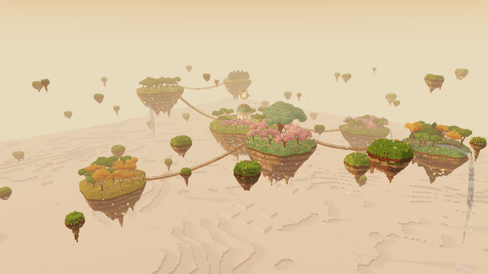
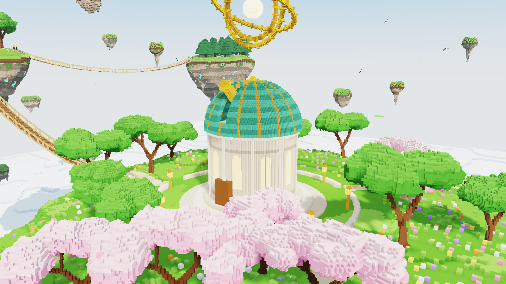
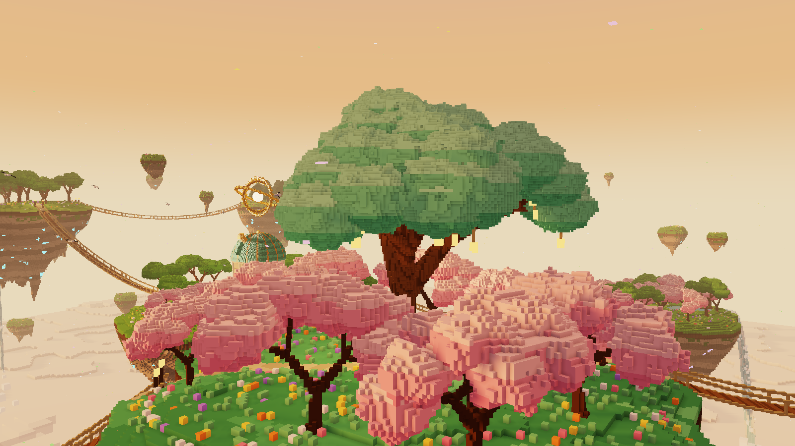
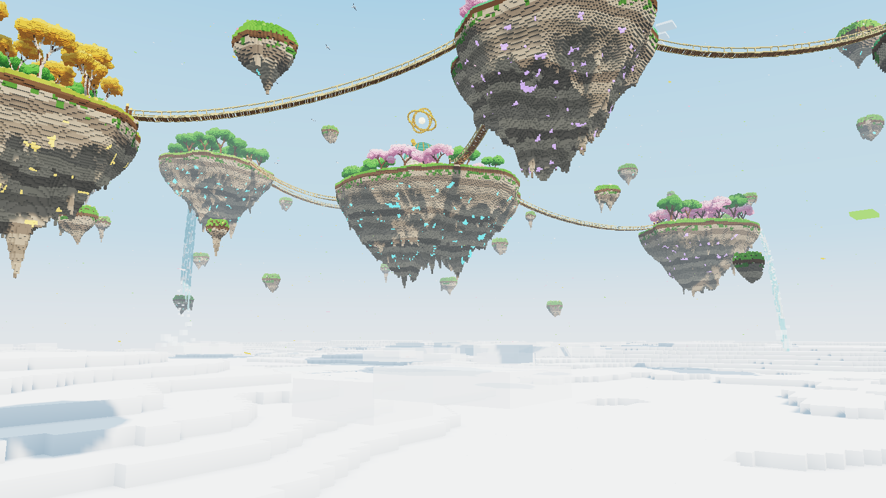
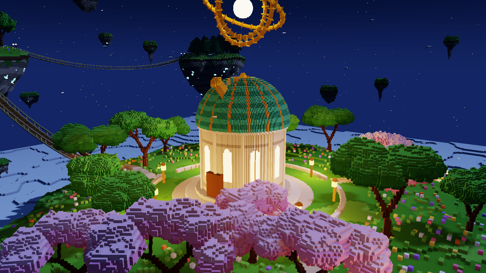
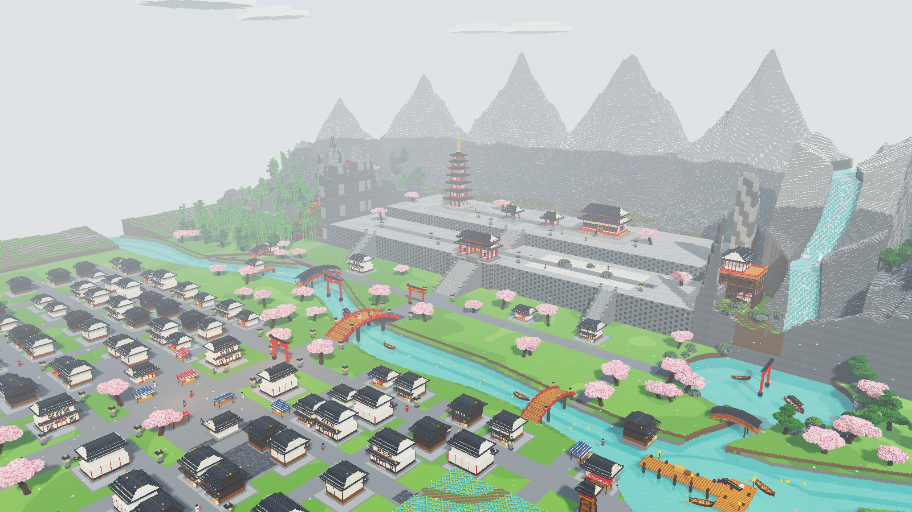

# Voxel Dioramas — wgpu

A native Rust + wgpu 30 + WGSL engine for micro-voxel dioramas, with several
fully procedural scenes. Forked from
[hakergeniusz/sakura-temple-wgpu](https://github.com/hakergeniusz/sakura-temple-wgpu)
and restructured into a multi-scene engine with a signed-distance-field (SDF)
toolkit, so new worlds are written as **math**, not hand-placed voxels.



| | |
|---|---|
|  |  |
|  |  |
|  | |

## Scenes

| id | Scene | Highlights |
|---|---|---|
| `sky-islands` | **Sky Islands** (default) | 7 floating islands above a cloud sea, observatory with a spinning armillary sphere, catenary rope bridges, recursive trees, ballistic waterfalls |
| `sakura` | **Sakura Empire** | The original 896×896 micro-terrain diorama: pagoda, town, river, harbor, 2,800 GPU petals |

### Sky Islands: how each piece is generated

| Element | Math |
|---|---|
| Island placement | Golden-angle spiral: `θᵢ = 0.6 + i·π(3−√5)`, radius and height also functions of `i` |
| Island outline | `R(θ) = r·(0.74 + 0.52·fbm(cos θ, sin θ))` |
| Island top | fbm height-field, flattened inside the plaza by a smoothstep, lake basins carved by an ellipse mask |
| Island underside | Inverted paraboloid `−depth·(1−e)^0.62·(0.6 + 0.8·ridged(x,z))` |
| Rock strata / crystals | `band = ⌊0.55y + 3·fbm⌋`; glowing veins where 3D `noise3(p) > 0.83` |
| Stalactites | Tapered-capsule SDFs on a golden spiral under each island |
| Waterfalls | Ballistic arc `p(t) = lip + d·v₀t − ½gt²ŷ`, swept as a ribbon of capsules; spray particles ride the same curve |
| Rope bridges | Catenary `c(s) = (cosh k(s−½) − cosh k/2)/(cosh k/2 − 1)`, planks spaced evenly by arc length; a nearest-inward-neighbour tree links every island |
| Observatory | One composite SDF: CSG of cylinders, a shelled sphere minus a slit box, polar repetition for windows, ribs and pilasters |
| Armillary sphere | Three torus SDF rings, each tumbling on its own quaternion axis |
| Trees | Recursive branching (Rodrigues rotations, tapered capsules) with noise-displaced foliage ellipsoids; pines are stacked SDF cones |
| Tree placement | Poisson-disc sampling, rejecting water, paths and plazas |
| Footpaths | Distance to a ray with a sine wiggle, tapered to meet each bridge |
| Cloud sea | Opaque voxel height-field from smoothstepped fbm, so islands cast shadows on it |
| Birds, islets | Parametric circles with banking; islets reuse the island generator at small radii |

## The engine

```
src/
  engine/
    app.rs        winit loop, input, scene switching, CLI
    gpu.rs        device, per-scene buffers, frame loop, offscreen capture
    pipelines.rs  GPU structs + render/compute pipelines
    camera.rs     orbit camera + Catmull-Rom tour
    scene.rs      Scene trait, SceneData, SceneBuilder
    voxel.rs      MicroVoxelVolume + greedy mesher with baked AO
    sdf.rs        SDF primitives, CSG ops, domain transforms, voxelisers
    math.rs       noise (2D/3D, fbm, ridged), RNG, golden spiral, Poisson disc
    shaders/      lighting, shadows, fog, ACES, stars, GPU particles
  scenes/
    mod.rs        registry
    sakura/       the original diorama
    sky_islands/  island, flora, observatory, bridges, effects, layout
```

### Writing shapes with the SDF toolkit

```rust
use crate::engine::prelude::*;
use crate::engine::sdf::*;

let mut vol = MicroVoxelVolume::new(160, 120, 160, 0.2, -80, 0, -80);
let (lo, hi) = vol.local_bounds();
// A domed tower with 10 windows, in four lines of math:
vol.fill_sdf(lo, hi, |p| {
    let tower = cylinder(p - Vec3::Y * 5.0, 6.0, 5.0);
    let dome = intersect(shell(sphere(p - Vec3::Y * 10.0, 6.4), 0.35), -(p.y - 10.0));
    union(tower, dome)
}, |p, _| {
    let q = repeat_polar(p, 10);
    Some(if q.z.abs() < 0.6 && p.y > 4.0 && p.y < 8.0 { (MAT_WIN, 0xffe2a0) } else { (MAT_MATTE, 0xcfc6b6) })
});
let (mesh, voxel_count) = vol.compile(&mut colors);
```

Voxelisers: `fill_sdf` (any SDF + paint callback), `carve_sdf` (subtract),
`fill_columns` (fast height-field solids), and `sweep` (tube along a curve).

### Adding a scene

1. Create `src/scenes/<name>/mod.rs` with a struct that implements `Scene`
   (`data()` and `update_dynamic_instances()`).
2. Build geometry with `SceneBuilder`: `add_mesh` for static meshes, `add_dynamic`
   for per-frame instances (emit them in the same order in `update_dynamic_instances`).
3. Register it in `src/scenes/mod.rs`.

## Run

Requires Rust (stable) and a GPU with Vulkan, DX12 or Metal.

```
cargo run --release                 # Sky Islands
cargo run --release -- sakura       # Sakura Empire
cargo run --release -- --list       # list scene ids
cargo test --release                # unit + scene consistency tests
```

### Offscreen screenshots

```
cargo run --release -- sky-islands --size 1920x1080 --shot 1:0:20:overview.png --shot 3:2:20:armillary.png
```

`--shot preset:time:seconds:path`: preset is 1–9, time is 0 = day, 1 = sunset /
golden hour, 2 = night, seconds is the simulation time. You can repeat `--shot`.

## Controls

- **Left-drag**: orbit · **Right-drag**: pan · **Scroll**: zoom
- **`Tab`** / **`` ` ``**: next / previous scene
- **`T`** or **`Space`**: toggle the cinematic tour
- **`N`** or **`L`**: cycle time of day
- **`P`**: pause / resume animation and particles
- **`1`–`9`**: camera presets · **`R`**: reset view · **`Esc`**: exit

## License

- **Code**: MIT, see [LICENSE](LICENSE). The original sakura diorama and engine
  core are by the upstream author.
- **Visuals**: procedurally generated at runtime; the rendered output and diorama
  designs are dedicated to the public domain via [CC0 1.0](https://creativecommons.org/publicdomain/zero/1.0/).
